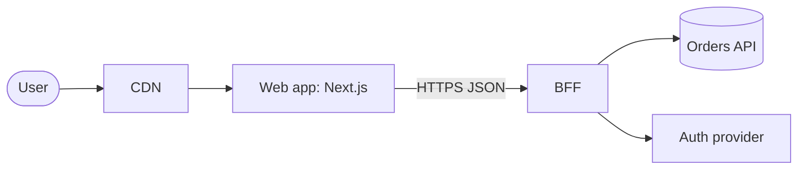

# Frontend Architecture and System Design: Guide

## Toolkit

### DevTools and tooling

Architecture work is mostly reading dependency graphs and making rules executable, so the tools that matter are the ones that show you what imports what and fail the build when a rule is broken.

- **dependency-cruiser** draws and validates the import graph. `npx depcruise src --include-only "^src" --output-type dot | dot -T svg > graph.svg` (needs Graphviz) gives you a picture; a `.dependency-cruiser.cjs` file with `forbidden` rules turns layering into a CI check. `npx madge --circular --extensions ts,tsx src` is the quickest way to list cycles.
- **ESLint** carries the day-to-day rules: the core `no-restricted-imports` rule, `import/no-cycle`, `eslint-plugin-boundaries`, or `@nx/enforce-module-boundaries` if you use Nx. Lint rules give feedback in the editor, which is where boundary violations should be caught.
- **Knip** (`npx knip`) finds unused files, exports, and dependencies. Run it before any architecture review: dead code distorts the graph.
- **Monorepo task runners**: `turbo run build --dry=json` and `turbo run build --summarize` show what would run and why a cache missed; `nx graph` opens an interactive project graph and `nx graph --affected` highlights what a change touches.
- **Bundle analysers** (`rollup-plugin-visualizer` for Vite, `@next/bundle-analyzer`, or your bundler's own report) show whether module boundaries survive into chunks, and what a shared package really costs.
- **Codemod tools**: `jscodeshift` for scripted AST transforms, `ast-grep` for pattern-based search and rewrite, and astexplorer.net for seeing the AST of a snippet while you write either.
- **Diagrams as code**: Mermaid renders in GitHub markdown, so a diagram can live next to the code and be reviewed in a PR. Structurizr does the same for the C4 model.
- **Browser DevTools**: the Network panel (waterfall, initiator column, `Cache-Control` headers) and the Performance panel are how you verify a rendering or data-layer decision actually behaves as designed.

### Testing and verifying your work

An architectural rule that is not checked by a machine is a suggestion. "Done" for work in this module means the decision is written down, the rule is enforced, and you measured the thing you claimed to improve.

- **Boundaries**: add a deliberate violation (import a feature's internal file from another feature) and confirm lint or `depcruise` fails in CI. If nothing fails, the rule does not exist.
- **Cycles**: `madge --circular` or the `no-circular` dependency-cruiser rule should report zero, and stay in CI so it stays zero.
- **Domain logic**: you should be able to unit-test pricing, permissions, and validation with plain function calls, without rendering a component or mocking `fetch`. If a test needs a DOM, logic has leaked into the view.
- **API contracts**: generate types (and mock handlers) from the API schema and regenerate in CI; a diff in the generated file is a contract change someone must look at.
- **Public APIs**: for packages, run `npx publint` and `npx @arethetypeswrong/cli --pack` to verify the `exports` map and types resolve for consumers. For a component library, the Storybook stories plus accessibility checks are the contract tests.
- **Migrations and codemods**: run the codemod with `--dry`, review a sample of the diff by hand, then run the type-checker and test suite. Count remaining usages with a script so progress is a number.
- **CI speed**: track p50 and p90 pipeline duration and cache hit rate. A change that "speeds up CI" needs before and after numbers.
- **Designs**: review a system design against its stated requirements. Every requirement should map to a component in the diagram, and every component should exist because of a requirement.
- **Documents**: an ADR or RFC is done when someone who was not in the room can explain the decision and its rejected alternatives after reading it.

### Tricks and gotchas

- Start an architecture review from the import graph and the git history, not the folder names. `git log --format= --name-only --since="6 months ago" | sort | uniq -c | sort -rn | head -30` lists the files that change most; files that change together but live far apart are your real coupling.
- Barrel files (`index.ts` re-exporting everything) are good as a deliberate public API for a feature and bad as a habit inside one: they create import cycles and can defeat tree shaking and slow dev servers.
- TypeScript path aliases do not enforce anything. `@/features/cart/internal/thing` resolves fine unless a lint rule forbids it.
- `import type` cycles are harmless at runtime but still signal tangled design; value-import cycles cause `undefined` at module evaluation time, which is the bug you will actually hit.
- "Shared" and "utils" folders grow until they are the biggest module in the app. Give shared code an owner and a rule: it may not import from features.
- In monorepos, a cache that never hits is almost always an undeclared input: an environment variable not listed in `env`, or a task writing outside its declared `outputs`.
- Micro-frontends solve an organisational problem. If you cannot name the teams that need independent deploys, you do not need them.
- A migration that is 90% complete is two systems to maintain. Plan the last 10% before you start, including who deletes the old code.
- In a design interview, say the trade-off out loud. "Cursor pagination, because the feed is prepended to constantly and offsets would duplicate items" is worth more than the correct choice made silently.
- Record a decision when you make it. Reconstructed ADRs are fiction.

### Official references

- [patterns.dev](https://www.patterns.dev/) - catalogue of rendering, design, and performance patterns with trade-offs.
- [web.dev: Rendering on the Web](https://web.dev/articles/rendering-on-the-web) - the canonical comparison of CSR, SSR, static rendering, and hydration strategies.
- [Martin Fowler: Micro Frontends](https://martinfowler.com/articles/micro-frontends.html) - the reference essay on composition approaches and their costs.
- [Turborepo docs: Structuring a repository](https://turborepo.dev/docs/crafting-your-repository/structuring-a-repository) - workspace layout, internal packages, and task configuration.
- [Nx docs: Enforce module boundaries](https://nx.dev/docs/features/enforce-module-boundaries) - tag-based dependency constraints.
- [dependency-cruiser](https://github.com/sverweij/dependency-cruiser) - rules reference and CLI for validating the import graph.
- [GitHub Docs: About code owners](https://docs.github.com/en/repositories/managing-your-repositorys-settings-and-features/customizing-your-repository/about-code-owners) - CODEOWNERS syntax and review rules.
- [jscodeshift](https://jscodeshift.com/) and [ast-grep](https://ast-grep.github.io/) - codemod tooling.
- [Architecture Decision Records](https://adr.github.io/) - templates and tooling for ADRs.
- [The C4 model](https://c4model.com/) - a small, consistent vocabulary for architecture diagrams.
- [WAI-ARIA Authoring Practices Guide](https://www.w3.org/WAI/ARIA/apg/) - keyboard and ARIA patterns that system-design answers for widgets must follow.
- [GreatFrontEnd: Front End System Design Playbook](https://www.greatfrontend.com/front-end-system-design-playbook) - a structured approach to frontend design interviews.

## Skills

### Module boundaries

A module boundary is a line across which code talks through a small, intended interface. The first decision is what the modules are. Organising by file type (`components/`, `hooks/`, `utils/`, `api/`) spreads every feature across the tree, so one change to checkout touches five folders and nothing tells you which files belong together. Organising by feature or domain puts things that change together in one place:

```text
src/
  app/            routing, providers, composition root
  features/
    cart/         components/ model/ api/ index.ts
    checkout/
    catalog/
  shared/
    ui/           design-system components, no business logic
    lib/          date, money, http client
```

Three rules make this work. Features do not import each other's internals. `shared` never imports from `features`. `app` is the only place that wires features together. When two features need the same thing, it either moves down into `shared` (if it is generic) or one feature exposes it deliberately through its public API.

The common mistakes are slicing too finely (a "feature" per component), letting `shared` become a dumping ground with business logic in it, and mixing both schemes so nobody knows where a new file goes. Framework routing folders (`app/` in Next.js, `routes/` elsewhere) are not your feature modules: keep route files thin and have them import from features. The test of a good boundary is deletion: you should be able to remove a feature folder and get compile errors only in the composition root.

**Try it:** Pick one feature in a project you know and list every file a typical change to it touches. Move them into one `features/<name>/` folder, fix imports, and count how many files outside the folder import from inside it. Each of those is a boundary decision to make.

**Resources**
- [Feature-Sliced Design: Overview](https://feature-sliced.design/docs/get-started/overview)
- [Kent C. Dodds: Colocation](https://kentcdodds.com/blog/colocation)
- [Martin Fowler: PresentationDomainDataLayering](https://martinfowler.com/bliki/PresentationDomainDataLayering.html)

### Dependency direction

Dependencies should point one way: from volatile, specific code toward stable, general code. In a frontend that usually means `app → features → shared`, and inside a feature `ui → model → api`. The reason is change propagation. If `shared/ui/Button` imports from `features/cart`, every cart change can break every screen, and the cart can no longer be understood, tested, or code-split alone.

Cycles are the extreme case. With a value-import cycle, one module evaluates while the other is still half-initialised, and you get `undefined is not a function` or a temporal dead zone error that depends on import order. Bundlers also cannot split a cycle into separate chunks cleanly.

Conventions do not survive deadlines, so encode the direction. dependency-cruiser does it with path rules:

```js
// .dependency-cruiser.cjs
module.exports = {
  forbidden: [
    { name: 'no-circular', severity: 'error', from: {}, to: { circular: true } },
    {
      name: 'shared-is-a-leaf',
      severity: 'error',
      from: { path: '^src/shared' },
      to: { path: '^src/(features|app)' },
    },
    {
      name: 'features-only-via-index',
      severity: 'error',
      from: { path: '^src/features/([^/]+)/' },
      to: {
        path: '^src/features/([^/]+)/',
        pathNot: ['^src/features/$1/', '^src/features/[^/]+/index\\.ts$'],
      },
    },
  ],
};
```

Run it with `npx depcruise src --config .dependency-cruiser.cjs` in CI. In an Nx workspace the equivalent is tags plus `@nx/enforce-module-boundaries`; with plain ESLint, `import/no-cycle` and `eslint-plugin-boundaries` cover the same ground. When a lower layer needs something from a higher one, invert it: the lower layer defines an interface or accepts a callback, and the composition root passes the implementation in.

**Try it:** Run `npx madge --circular --extensions ts,tsx src` on a real project. Pick one cycle, work out which import is the "wrong way" one, and break it by moving the shared piece down or injecting it. Then add the `no-circular` rule to CI.

**Resources**
- [dependency-cruiser: Rules reference](https://github.com/sverweij/dependency-cruiser/blob/main/doc/rules-reference.md)
- [Nx docs: Enforce module boundaries](https://nx.dev/docs/features/enforce-module-boundaries)
- [eslint-plugin-import: no-cycle](https://github.com/import-js/eslint-plugin-import/blob/main/docs/rules/no-cycle.md)

### Public APIs

A module's public API is what other code is allowed to depend on. Everything else is an implementation detail you can change without asking anyone. The smaller the surface, the cheaper the module is to change, so the default for any new file is private.

Inside an app, the public API of a feature is its `index.ts`:

```ts
// features/cart/index.ts
export { CartButton } from './components/CartButton';
export { useCart } from './model/useCart';
export type { CartItem } from './model/types';
```

Enforce it, because path aliases will happily resolve deep imports. The simplest guard is ESLint's core rule:

```js
// eslint.config.js
export default [
  {
    rules: {
      'no-restricted-imports': ['error', {
        patterns: [{
          group: ['@/features/*/*'],
          message: 'Import a feature through its index.ts.',
        }],
      }],
    },
  },
];
```

Inside a feature, use relative imports so this rule does not fire on your own internals.

For a package, the public API is the `exports` field in `package.json`. Once `exports` is present, Node and bundlers refuse any subpath not listed, which is real encapsulation:

```json
{
  "name": "@acme/ui",
  "type": "module",
  "exports": {
    ".": { "types": "./dist/index.d.ts", "default": "./dist/index.js" },
    "./styles.css": "./dist/styles.css"
  }
}
```

Mistakes to avoid: `export *` from everything (the surface becomes "whatever exists"), exporting internal types that then freeze your data model, and exposing a store or cache object directly instead of functions and hooks. Design the API from the consumer's side: what is the least they need to know?

**Try it:** Add an `index.ts` to one feature that exports only what other code currently uses, add the lint rule, and fix the violations. Note which exports surprised you; those are leaks.

**Resources**
- [Node.js docs: Package entry points](https://nodejs.org/api/packages.html#package-entry-points)
- [ESLint: no-restricted-imports](https://eslint.org/docs/latest/rules/no-restricted-imports)
- [Feature-Sliced Design: Public API](https://feature-sliced.design/docs/reference/public-api)

### Coupling and cohesion

Coupling is how much one module must know about another; cohesion is how strongly the things inside a module belong together. You want high cohesion and low coupling, but the useful skill is recognising the kinds of coupling, because some are invisible in the import graph.

- **Import coupling**: A imports B. Visible, lintable.
- **Data-shape coupling**: twenty components read `user.profile.address.city` straight from an API response. Rename the field on the server and all twenty break. Map responses to your own types at the boundary.
- **Global-state coupling**: two features communicate by writing and reading the same store key. Neither imports the other, yet neither works alone.
- **Temporal coupling**: `init()` must be called before `track()`, and nothing says so.
- **Styling coupling**: a parent styles a child's internals with descendant selectors or relies on its DOM structure.
- **Change coupling**: files that always change in the same commit. This is the most honest measure, and git can show it.

Accidental coupling is coupling the problem does not require. Checkout needing the cart's total is essential. Checkout importing the cart's reducer to compute it is accidental.

Reduce it by narrowing what crosses the boundary (pass `total`, not the cart object), by depending on functions rather than data layout, and by moving code so that things that change together live together. Do not over-correct: an event bus between two modules that are always deployed and changed together replaces visible coupling with hidden coupling and makes the code harder to follow. Low cohesion shows up as files named `helpers.ts` and modules whose description needs the word "and".

**Try it:** Run `git log --format= --name-only -n 200 | sort | uniq -c | sort -rn | head -20` to find hot files, then look at five recent commits touching the top one. Which other files changed with it every time? Decide whether they should be one module or whether a narrower interface would separate them.

**Resources**
- [Martin Fowler: Reducing Coupling](https://martinfowler.com/ieeeSoftware/coupling.pdf)
- [Kent C. Dodds: Colocation](https://kentcdodds.com/blog/colocation)

### Abstraction timing

An abstraction is a bet that several pieces of code will keep changing together. Make the bet too early and you guess the wrong axis of variation. The cost of that is higher than the cost of duplication: once a shared component or hook exists, each new caller adds a flag to make it fit, and a year later you have a `Table` with 40 props where every change risks every screen.

The working rule is to tolerate duplication until you have seen the pattern about three times and can name what varies and what does not. Two similar-looking blocks are often similar by coincidence: an "Edit user" form and an "Edit organisation" form look alike today and diverge the moment product treats them differently. Code that is the same *for the same reason* (a money formatter, a retry policy) is safe to share early.

When you do abstract, extract the smallest stable thing. Prefer composition over configuration: a `<Card>` that accepts children ages better than one that accepts `title`, `subtitle`, `showFooter`, and `footerVariant`. And know the exit: when an abstraction has grown conditionals for each caller, inline it back into the callers, delete what each does not use, and look again for what is truly common.

```tsx
// A warning sign: the abstraction knows about its callers
function List({ items, isAdminView, isCheckout, compact, onRowClick }: ListProps) {
  /* branches on every flag */
}
```

The opposite failure is real too: copy-pasting a subtle bug fix into nine places because nobody would extract the retry logic. Timing is the skill, not a preference for one side.

**Try it:** Find a component or hook in your codebase with three or more boolean props. For each caller, write down which flags it sets. If no two callers use the same combination, sketch what the code looks like inlined and decide which is easier to change.

**Resources**
- [Sandi Metz: The Wrong Abstraction](https://sandimetz.com/blog/2016/1/20/the-wrong-abstraction)
- [Kent C. Dodds: AHA Programming](https://kentcdodds.com/blog/aha-programming)

### Separation of concerns

In a frontend, the separation that pays off is between *what the product does* and *how it is shown*. Rules like "an order over 100 ships free", "editors can publish but not delete", or "a discount cannot exceed the subtotal" are domain logic. They should be plain functions over plain data, with no React, no `fetch`, no router, and no DOM, so they can be tested in milliseconds and reused on a server, in a worker, or in another framework after a migration.

```ts
// features/cart/model/pricing.ts: no framework imports
export function cartTotal(items: CartItem[], discount: Discount | null): Money {
  const subtotal = items.reduce((sum, i) => sum + i.unitPrice * i.qty, 0);
  const off = discount ? Math.min(subtotal, applyDiscount(subtotal, discount)) : 0;
  return subtotal - off;
}
```

The component's job is then to render state and translate events into calls. A useful layering inside a feature is: `api` (talks to the network, maps DTOs to domain types), `model` (domain types, pure rules, state transitions), `ui` (components and hooks that connect the two).

Signs that concerns are tangled: a business rule appears inside a JSX conditional; the same calculation exists in two components with slightly different rounding; a test for a rule needs `render()` and network mocks; a `useEffect` both fetches data and decides policy. Do not push this into ceremony. A formatting helper used once can live in the component, and wrapping every call in a "use case" class adds indirection without benefit. Extract when the logic is a rule the business would recognise.

Server-rendered frameworks add a second axis: which code runs on the server. Keep secrets and data access in server-only modules and keep the pure domain module importable from both sides.

**Try it:** Find a component that computes something non-trivial inline (a total, a permission check, a validation). Move it into a pure function in a `model` file and write three unit tests for it without importing any UI library.

**Resources**
- [React docs: Keeping Components Pure](https://react.dev/learn/keeping-components-pure)
- [Martin Fowler: PresentationDomainDataLayering](https://martinfowler.com/bliki/PresentationDomainDataLayering.html)

### Conventions

A convention is a decision made once so that nobody has to make it again. Its value is that any engineer can predict where code lives and what it looks like. Its weakness is that written conventions decay. The fix is to move each convention as far as possible from "document" toward "the tool does it":

1. **Automate it**: formatter, lint rule with autofix, type constraint.
2. **Generate it**: a scaffold (`plop`, `nx generate`, `turbo gen`) that creates a feature folder with the right files, test, and `index.ts`.
3. **Check it**: a CI rule (dependency-cruiser, a filename lint, a schema check) that fails on violations.
4. **Document it**: only for what cannot be automated, in a short `CONTRIBUTING.md` or ADR that explains why.

Worth codifying: folder structure and naming, where data fetching happens, how errors are surfaced, how a feature exposes its API, import ordering, test file placement, and commit or PR conventions. Share the configuration itself as code: an internal ESLint config, a `tsconfig` base, and a Prettier config in a package that every project extends, so a rule change is one PR.

The "pit of success" idea is the test: is the correct thing the path of least effort? If creating a feature the right way takes a generator command and the wrong way takes manual work, people do the right thing. If the convention needs a reviewer to remember it, it will be enforced inconsistently and resented.

Mistakes: adopting a large rule set nobody agreed to, adding rules without autofix that produce hundreds of warnings (warnings that do not fail CI are ignored), and never revisiting rules. Introduce a new rule as an error on changed files only, or with a recorded baseline, and burn the baseline down.

**Try it:** Take one convention your team repeats in code review ("don't import from another feature's internals", "name hooks files `useX.ts`"). Implement it as a lint rule or dependency-cruiser rule and make CI fail on a deliberate violation.

**Resources**
- [ESLint: Shareable configs](https://eslint.org/docs/latest/extend/shareable-configs)
- [Turborepo docs: Generating code](https://turborepo.dev/docs/guides/generating-code)
- [typescript-eslint: Shared configs](https://typescript-eslint.io/users/configs/)

### Rendering architecture

Rendering architecture answers two questions per route: where is the HTML produced (build, server, edge, browser) and how much JavaScript must run before the page is usable. Choose per product need, not per fashion.

| Approach | HTML produced | Good fit | Main cost |
| --- | --- | --- | --- |
| MPA / static | Build time or server, full page loads | Content, docs, marketing | Less app-like transitions |
| SPA (client rendering) | Browser | Authenticated tools behind a login, long sessions | Slow first load, weak SEO, big bundles |
| SSR + hydration | Server per request | Dynamic, personalised, SEO-relevant pages | Server cost, hydration cost on the client |
| Islands | Server, with small hydrated widgets | Mostly static pages with pockets of interactivity | Cross-island state is harder |
| Server components + streaming | Server, with client components where needed | Data-heavy apps wanting small client bundles | Mental model, framework lock-in |

The questions that decide it: Does the page need to be indexed or shared with link previews? How dynamic and how personalised is the data? How long are sessions (one page view or eight hours)? What devices and networks do users have? Do you have, or want, a server to run?

Most real products are hybrids: static marketing pages, server-rendered product pages with CDN caching, and a client-heavy dashboard. Modern meta-frameworks let you pick per route, which is the point: make the default cheap (static or server-rendered) and opt in to client rendering where interaction demands it.

Mistakes: choosing a SPA for a content site and then fighting SEO and LCP; server-rendering everything and shipping the same JavaScript anyway, so the page looks ready but does not respond (poor INP); and ignoring the operational side (SSR needs servers, caching rules, and handling of version skew). Framework specifics move quickly, so check current docs: for example, Next.js 16 runs routes on the Node.js runtime and no longer supports per-route `runtime = 'edge'` as of 16.3.

**Try it:** Take three routes of one product (landing, product detail, account settings). For each, write one sentence choosing a rendering mode and one naming the metric you expect it to help. Then load each in DevTools with JavaScript disabled and see what the user actually gets.

**Resources**
- [web.dev: Rendering on the Web](https://web.dev/articles/rendering-on-the-web)
- [Astro docs: Islands architecture](https://docs.astro.build/en/concepts/islands/)
- [Next.js docs: Server and Client Components](https://nextjs.org/docs/app/getting-started/server-and-client-components)

### Data layer design

The data layer is the part of the app that owns talking to servers and holding what came back. The central idea is that **server state is a cache, not application state**. It has an owner elsewhere, it can be stale, and several components want the same piece. Treating it like local state (fetch in `useEffect`, store in `useState`) gives you duplicate requests, inconsistent screens, and race conditions.

Decide four things explicitly:

1. **Where fetching happens.** Route loaders or server components (fetch before render, no waterfalls), or a client cache library such as TanStack Query, SWR, RTK Query, or Apollo. Avoid ad hoc `fetch` calls inside components.
2. **How the cache is keyed and invalidated.** Query keys are your schema: `['todos', { status }]`. After a mutation, invalidate or update the keys it affects. Centralise keys in a factory so invalidation is not string-matching.
3. **Whether to normalise.** A document cache stores each response under its key; the same entity can exist in several entries and you reconcile by invalidation. A normalised cache (Apollo, Relay, RTK entity adapters) stores each entity once by ID, so an update appears everywhere, at the price of more machinery. Normalise when the same entities appear in many views and are edited often.
4. **Where mapping happens.** Convert API DTOs to domain types in one `api` module per feature, validated at the boundary, so a backend rename is a one-file change.

```ts
export const todoKeys = {
  all: ['todos'] as const,
  list: (filters: Filters) => [...todoKeys.all, 'list', filters] as const,
  detail: (id: string) => [...todoKeys.all, 'detail', id] as const,
};
```

Keep client-only state (open panels, drafts, selection) separate and small, and put shareable view state (filters, page, tab) in the URL. Mistakes: copying query results into a global store (two sources of truth), `staleTime` left at zero everywhere so every mount refetches, and request waterfalls from parent-then-child fetching.

**Try it:** Open the Network panel on a screen of your app and navigate to it from another screen. Count duplicate requests and requests that only start after another finishes. For each, name the data-layer decision (key, stale time, loader) that would remove it.

**Resources**
- [TanStack Query docs: Important defaults](https://tanstack.com/query/latest/docs/framework/react/guides/important-defaults)
- [Redux docs: Normalizing state shape](https://redux.js.org/usage/structuring-reducers/normalizing-state-shape)
- [TkDodo: Effective React Query keys](https://tkdodo.eu/blog/effective-react-query-keys)

### API contract design

The API contract is the most expensive interface in a frontend because two teams and two deploy schedules depend on it. Treat it as a design artefact you co-own, not something handed to you. Get involved before implementation: bring the screens, list what each needs, and negotiate shape, pagination, errors, and naming.

What to push for as the client:

- **Screen-shaped reads.** One request per view where practical; avoid N+1 from the browser (list, then one request per row).
- **Cursor pagination** for anything that changes while being read.
- **A consistent error format** (for HTTP APIs, RFC 9457 Problem Details) with machine-readable codes the UI can map to messages.
- **Additive evolution.** New optional fields are safe; removing or renaming is a breaking change. Clients must ignore unknown fields.
- **Idempotency keys** on writes the client may retry.
- **A machine-readable schema** (OpenAPI or a GraphQL schema) from which you generate types, so drift is a compile error.

When backends are many or generic, add an aggregation layer. A **backend for frontend (BFF)** is a server owned by the frontend team that calls downstream services and returns exactly what one client needs. It is also the right place for auth token handling and for hiding service topology. Its cost is another deployable to run and the risk of business logic accumulating in it. **GraphQL** gives clients a typed graph and lets each view declare its data; it removes over- and under-fetching and suits many clients with different needs. Its costs are server complexity (resolver N+1, query cost limiting), HTTP caching that no longer works by URL, and a client cache to learn. For one web client and one team, typed REST or RPC (tRPC, server functions) is usually simpler.

**Try it:** For one screen, write the ideal response as a TypeScript type before looking at the real API. Compare it with what the API returns and list each difference as: reshape in a BFF, ask the backend to change, or accept and map on the client.

**Resources**
- [OpenAPI Initiative: Getting started](https://learn.openapis.org/)
- [Sam Newman: Backends For Frontends](https://samnewman.io/patterns/architectural/bff/)
- [GraphQL docs: Thinking in graphs](https://graphql.org/learn/thinking-in-graphs/)

### Error handling strategy

Without a strategy, each component invents its own handling, and users get a mix of blank screens, raw messages, and silent failures. A strategy answers: what kinds of errors exist, where is each caught, what does the user see, and what gets reported.

Classify first, because the response differs:

- **Expected, user-correctable**: validation, conflict, not found, not permitted. Show inline, next to the cause, with what to do. Do not report as errors.
- **Transient**: network drop, timeout, 502/503. Retry with backoff for idempotent requests, show offline or retry UI.
- **Auth**: 401 triggers refresh or re-login in one central place; 403 is a permission state to render.
- **Bugs**: unexpected exceptions. Contain them, show a fallback, report with context.

Then define layers. Normalise at the API client so the rest of the app sees one error type:

```ts
export class ApiError extends Error {
  constructor(
    readonly status: number,
    readonly code: string,
    message: string,
    readonly fields?: Record<string, string>,
  ) {
    super(message);
  }
}
```

Place error boundaries at meaningful granularity: one at the app root as a last resort, one per route, and one around each independent widget so a broken chart does not take down the page. Remember what React error boundaries do not catch: event handlers, asynchronous code, and server rendering errors. Those go through your data layer's error state or explicit `try/catch`. Install global `error` and `unhandledrejection` listeners (your error tracker does this) as the safety net.

Rules of thumb: never swallow (`catch {}`), never show a raw server message, always preserve user input after a failed submit, and give every fallback a way forward (retry, reload, go back). Decide which errors toast and which render inline, and write it down.

**Try it:** In DevTools, block one API request (Network panel, right-click, Block request URL) and reload. Record what the user sees and what was reported. Repeat with a 500 via a local override and with the Offline throttle. Fix the worst of the three.

**Resources**
- [React docs: Catching rendering errors with an error boundary](https://react.dev/reference/react/Component#catching-rendering-errors-with-an-error-boundary)
- [RFC 9457: Problem Details for HTTP APIs](https://www.rfc-editor.org/rfc/rfc9457.html)
- [MDN: Window unhandledrejection event](https://developer.mozilla.org/en-US/docs/Web/API/Window/unhandledrejection_event)

### Auth architecture

Three separate problems hide under "auth": proving who the user is (session), keeping that proof valid (refresh), and deciding what they may see and do (permissions).

**Session.** The safest default for a web app is a server-set cookie with `HttpOnly; Secure; SameSite=Lax` (or `Strict`), holding either a session ID or an encrypted token. JavaScript cannot read it, so XSS cannot exfiltrate it. Cookies need CSRF protection for state-changing requests: `SameSite` plus origin checks or a CSRF token. Storing access tokens in `localStorage` exposes them to any script on the page. If your API requires bearer tokens, the current IETF guidance for browser apps recommends a BFF that holds the tokens server-side and gives the browser only a cookie.

**Refresh.** Access tokens are short-lived; a refresh token (rotated on each use) obtains new ones. On the client, the classic bug is a stampede: five requests get 401 at once and fire five refreshes, and rotation invalidates four of them. Use a single shared promise:

```ts
let refreshing: Promise<void> | null = null;

export async function api(input: string, init?: RequestInit): Promise<Response> {
  const res = await fetch(input, { ...init, credentials: 'include' });
  if (res.status !== 401) return res;
  refreshing ??= fetch('/auth/refresh', { method: 'POST', credentials: 'include' })
    .then((r) => { if (!r.ok) throw new Error('session expired'); })
    .finally(() => { refreshing = null; });
  await refreshing;
  return fetch(input, { ...init, credentials: 'include' });
}
```

Handle multiple tabs too: broadcast logout with `BroadcastChannel` so every tab leaves together.

**Permissions.** The UI checks permissions to shape the experience (hide, disable, explain); the server enforces them. Never treat a hidden button as security. Model permissions as capabilities (`can('invoice:approve')`) delivered with the session, not role names scattered through components, so a role change does not require a code search. Decide the behaviour for each state: loading (do not flash the login page), unauthenticated, forbidden, and expired mid-task (preserve the user's work and return them after login).

**Try it:** In DevTools Application > Cookies, inspect your session cookie's `HttpOnly`, `Secure`, and `SameSite` flags. Then delete it while on a page with unsaved input and trigger a request. Does the app recover without losing the input?

**Resources**
- [MDN: Using HTTP cookies](https://developer.mozilla.org/en-US/docs/Web/HTTP/Guides/Cookies)
- [IETF: OAuth 2.0 for Browser-Based Applications](https://datatracker.ietf.org/doc/html/draft-ietf-oauth-browser-based-apps)
- [OWASP: Session Management Cheat Sheet](https://cheatsheetseries.owasp.org/cheatsheets/Session_Management_Cheat_Sheet.html)

### Configuration

Configuration is everything that differs between deployments of the same code: API origins, keys, feature switches. There are three kinds, and mixing them up causes most config bugs.

**Build-time config** is inlined into the bundle by the bundler: `import.meta.env.VITE_API_URL` in Vite, `NEXT_PUBLIC_*` in Next.js. It is fixed when you build, so "build once, deploy everywhere" breaks: staging and production need separate builds, and the artefact you tested is not the one you ship. Anything inlined is public. A secret in a `VITE_` or `NEXT_PUBLIC_` variable is published to every visitor.

**Runtime config** is read when the app starts or a request is served: environment variables on the server, or for static frontends a small `/config.json` fetched at boot or values injected into the HTML by the server. This lets one artefact be promoted through environments. The cost is a little startup work and making sure the config response is not cached forever.

**Feature flags** are runtime config that changes without a deploy and can vary per user: release toggles (hide unfinished work), experiment flags, ops kill switches, and permission flags. They decouple deploy from release. They also multiply code paths, so each flag needs an owner and a removal date, and stale flags are debt.

Practices that hold up: validate config at startup with a schema and fail loudly (a missing variable should be a boot error, not `undefined/api/users` in production); expose one typed `config` module instead of reading `process.env` throughout the code; keep a committed `.env.example`; keep secrets out of the repository and out of client bundles; and make flag evaluation consistent across server and client rendering to avoid hydration mismatches and flicker.

```ts
import * as z from 'zod';

const Env = z.object({
  VITE_API_URL: z.url(),
  VITE_RELEASE: z.string().min(1),
});
export const config = Env.parse(import.meta.env);
```

**Try it:** Build your app and search the output for a value from your `.env` file (`grep -r "your-api-host" dist`). Then list every variable in the bundle and decide which should have been runtime config and whether any should not be public at all.

**Resources**
- [The Twelve-Factor App: Config](https://12factor.net/config)
- [Vite docs: Env variables and modes](https://vite.dev/guide/env-and-mode)
- [Martin Fowler: Feature Toggles](https://martinfowler.com/articles/feature-toggles.html)

### Cross-cutting concerns

Logging, analytics, i18n, theming, feature flags, and permissions touch every feature. If each feature calls the vendor SDK directly, you get vendor names in two hundred files, inconsistent event names, and a migration nobody can afford. The pattern for all of them is the same: **features depend on a small interface you own; one adapter in the app layer implements it.**

```ts
// shared/analytics/index.ts: the only API features see
export interface Analytics {
  track(event: AnalyticsEvent): void;
}
export type AnalyticsEvent =
  | { name: 'checkout_started'; cartValue: number }
  | { name: 'search_performed'; queryLength: number };
```

The typed event union is the tracking plan: an unknown event is a compile error, and replacing the vendor is one file. Provide the implementation at the composition root (context, a module-level setter, or dependency injection) and a no-op for tests.

Specifics by concern:

- **Logging**: one `logger` with levels and structured context (route, release, user ID hash). Never log tokens or personal data.
- **Analytics**: fire events from user-intent boundaries (event handlers, route changes), not from effects that re-run. Respect consent before loading the SDK.
- **i18n**: no string concatenation; use ICU messages for plurals and gender; format dates and numbers with `Intl`; load message catalogues per locale and per route; keep keys colocated with features but extracted by tooling.
- **Theming**: design tokens as CSS custom properties, switched by an attribute or `color-scheme`, so components reference `var(--color-surface)` and know nothing about themes. Avoid passing theme objects through JavaScript where CSS can do it.

Mistakes: a "core" module that imports every feature to register things (inverts the dependency direction), cross-cutting code that needs feature-specific branches, and wrappers so thin they leak the vendor's types.

**Try it:** Search your codebase for direct imports of an analytics or logging SDK. Count the files. Write the interface you would want instead and migrate one feature to it.

**Resources**
- [MDN: Intl](https://developer.mozilla.org/en-US/docs/Web/JavaScript/Reference/Global_Objects/Intl)
- [MDN: Using CSS custom properties](https://developer.mozilla.org/en-US/docs/Web/CSS/CSS_cascading_variables/Using_CSS_custom_properties)
- [OpenFeature: Introduction](https://openfeature.dev/docs/reference/intro)

### Testing architecture

Testing architecture is the decision about which kind of test is responsible for which kind of risk. Without that decision, teams end up with the same behaviour checked at three levels and whole classes of failure checked at none. Assign each concern to the cheapest level that can actually catch it:

| Level | What it verifies | Typical tools |
| --- | --- | --- |
| Static | Types, lint rules, module boundaries | TypeScript, ESLint, dependency-cruiser |
| Unit | Pure domain logic: pricing, permissions, reducers, formatters | Vitest |
| Component / integration | A feature as the user operates it, with the network mocked at the HTTP boundary | Testing Library, Vitest browser mode, MSW |
| Contract | The frontend's assumptions about the API match what the API does | Generated types from OpenAPI or GraphQL, Pact, schema validation |
| End-to-end | A few critical journeys through the real, deployed stack | Playwright |
| Visual / accessibility | Appearance and a11y regressions of components | Storybook with screenshot and axe checks |

The architecture and the test strategy shape each other. If domain logic is separated from components, most rules are covered by fast unit tests. If it is not, everything needs a rendered component and the suite is slow. Put the bulk of tests at the integration level, where one test exercises a feature through its public surface and survives refactoring; keep end-to-end tests few because they are slow and the flakiest.

Contracts are the gap most frontends leave open. A mocked test proves the UI works against the response *you imagined*. When the backend renames a field, every mocked test stays green and production breaks. Close it in one of three ways: generate types and mock handlers from the API's schema so a schema change fails compilation; run consumer-driven contract tests, where the frontend's tests record the requests and responses it relies on and the provider's CI verifies them; or validate responses at runtime with a schema at the API boundary and report mismatches.

```ts
// A mock handler typed from the generated schema: drift becomes a type error
import { http, HttpResponse } from 'msw';
import type { components } from './api-schema';

type Order = components['schemas']['Order'];

export const handlers = [
  http.get('/api/orders/:id', () =>
    HttpResponse.json<Order>({ id: 'o_1', status: 'paid', total: 4200 }),
  ),
];
```

Write the decisions down: what must have a unit test, what each feature's integration tests cover, which journeys are end-to-end, and who owns flaky tests. Mistakes: testing implementation details (state, internal calls) so refactors break tests; mocking your own modules instead of the network; snapshot tests nobody reads; and measuring coverage percentage instead of asking which failures would go unnoticed.

**Try it:** For one feature, list five ways it could break in production (a rule is wrong, a field is renamed, a button is unreachable by keyboard, a route fails to load, the layout shifts). Next to each, write the test level that would catch it and whether such a test exists today.

**Resources**
- [Martin Fowler: The Practical Test Pyramid](https://martinfowler.com/articles/practical-test-pyramid.html)
- [Pact docs: Introduction to contract testing](https://docs.pact.io/)
- [Mock Service Worker docs](https://mswjs.io/docs/)

### Monorepos

A monorepo is one repository holding several projects with explicit relationships. The benefits are atomic changes across apps and libraries, one version of each dependency, and shared tooling. The cost is that naive tooling scales with the size of the repo, so a monorepo needs three things: workspaces, a task graph, and caching.

**Structure.** The common layout is `apps/*` (deployables) and `packages/*` (libraries, config). Each has its own `package.json` with a name, scripts, and explicit dependencies using the workspace protocol (`"@acme/ui": "workspace:*"` in pnpm). Never import across packages by relative path.

**Task graph and caching.** Turborepo or Nx reads the package graph and runs tasks in dependency order, in parallel, hashing each task's inputs. If the hash matches a previous run, outputs and logs are restored instead of rebuilt; a remote cache shares that across CI and laptops.

```json
{
  "$schema": "https://turborepo.dev/schema.json",
  "tasks": {
    "build": { "dependsOn": ["^build"], "outputs": ["dist/**", ".next/**", "!.next/cache/**"] },
    "test": { "dependsOn": ["^build"] },
    "lint": {},
    "dev": { "cache": false, "persistent": true }
  }
}
```

`^build` means "build my dependencies first". Caching is only correct if inputs are declared: environment variables that affect output must be listed in `env` or `globalEnv`, or you will restore a build made with the wrong value.

**Affected-only.** On a PR, run tasks only for packages changed since the base and their dependents: `turbo run test --affected` or `nx affected -t lint test build`. Both need git history, so a shallow CI checkout makes everything look changed.

**Ownership.** Pair the layout with CODEOWNERS and boundary rules so "one repo" does not become "anyone edits anything".

Mistakes: one giant `packages/shared`, packages with undeclared dependencies that work only through hoisting, and adopting a monorepo for one app and one library that never change together.

**Try it:** In a Turborepo or Nx workspace, run the build twice and confirm the second run is fully cached. Then change one leaf package and run with `--dry` (Turborepo) or `nx graph --affected` to see exactly which tasks would re-run and why.

**Resources**
- [Turborepo docs: Structuring a repository](https://turborepo.dev/docs/crafting-your-repository/structuring-a-repository)
- [Turborepo docs: Configuring tasks](https://turborepo.dev/docs/crafting-your-repository/configuring-tasks)
- [pnpm docs: Workspaces](https://pnpm.io/workspaces)

### Shared packages

Shared packages turn code that several apps need into libraries with an owner and an interface. The typical set is a design system (`@acme/ui`), utilities (`@acme/utils`), an API client, and config packages (`@acme/eslint-config`, `@acme/tsconfig`).

Decide how each package is consumed, because it changes the workflow:

- **Just-in-time (source) packages**: `exports` points at TypeScript source and the consuming app's bundler compiles it. Zero build step and instant feedback; works only inside the monorepo, and every app must be able to compile the source.
- **Compiled packages**: the package builds to `dist` with JavaScript and `.d.ts` files. Slower loop, but cacheable, and the same package can be published.
- **Published packages**: versioned to a registry with semver and a changelog. Required when consumers live in other repositories. Now you own releases, deprecations, and several versions in the wild.

Inside one monorepo, prefer "everyone uses the current version" (`workspace:*`) so there is no version matrix; reach for published versioning only when consumers cannot upgrade in step.

Design rules for the package itself: a narrow `exports` map; `peerDependencies` for frameworks the host provides (`react`), never bundled copies; correct `sideEffects` so tree shaking works; no app-specific logic; and one external dependency version across the repo (pnpm catalogs help). Split by reason to change, not by size: a single `shared` package that everything depends on invalidates every cache when one helper changes.

```json
{
  "name": "@acme/ui",
  "type": "module",
  "sideEffects": ["**/*.css"],
  "exports": {
    ".": { "types": "./dist/index.d.ts", "default": "./dist/index.js" },
    "./styles.css": "./dist/styles.css"
  },
  "peerDependencies": { "react": "^19.0.0", "react-dom": "^19.0.0" }
}
```

A shared package is a product with users. It needs documentation, an owner who reviews changes, and a way to make breaking changes (codemods, deprecation periods). Without that, teams fork it or stop sharing.

**Try it:** Run `npx publint` and `npx @arethetypeswrong/cli --pack` in one of your packages (or any small library). Fix one reported problem with `exports` or types and note what a consumer would have experienced.

**Resources**
- [Turborepo docs: Internal packages](https://turborepo.dev/docs/core-concepts/internal-packages)
- [Node.js docs: Package entry points](https://nodejs.org/api/packages.html#package-entry-points)
- [pnpm docs: Catalogs](https://pnpm.io/catalogs)

### Micro-frontends

Micro-frontends split one product's frontend into independently built and deployed applications, each owned by one team, composed into a single experience. The goal is organisational: team autonomy and independent release cadence. They do not make the frontend technically better, and they make several things worse.

Composition options, from least to most coupled at runtime:

- **Route-level (multi-app behind one domain)**: a proxy or CDN routes `/checkout/*` to one app and `/account/*` to another. Full page loads between zones. Simple, robust, and often enough.
- **Server-side composition**: a server or edge layer stitches fragments into one HTML response.
- **Runtime JavaScript integration**: a shell loads remote bundles in the browser. **Module Federation** is the common mechanism: a remote exposes modules, a host consumes them at runtime, and shared dependencies such as `react` are negotiated as singletons. Module Federation 2.0 adds a runtime, a manifest, and generated types on top of the original webpack feature and supports webpack and Rspack, with integrations for other bundlers.
- **`<iframe>`**: strongest isolation, weakest integration.

The costs are real. Duplicate or mismatched dependencies increase payload and break singletons (two React copies). Version skew between shell and remotes becomes a production failure mode you must design for. UX consistency depends on every team upgrading the design system. Cross-app state, routing, auth, and error handling need contracts. Local development and end-to-end testing get harder, and observability must attribute errors to the right team. You also need a platform team to own the shell and shared infrastructure.

It is justified when several teams are blocked by a shared release train, the domains are separable along routes, and you can fund the platform work. It is not justified for one or two teams, or to "use multiple frameworks". Try first: a modular monolith in a monorepo with enforced boundaries, ownership, and fast CI. That gives most of the autonomy at a fraction of the cost.

Keep contracts thin: communicate through URLs, custom events, and a small shared shell API; do not share stores.

**Try it:** Take a product you know and draw where you would cut it into three micro-frontends. For each cut, list what crosses it (auth, navigation, shared state, design system). If more than a few things cross, the cut is in the wrong place or the split is not worth it.

**Resources**
- [Martin Fowler: Micro Frontends](https://martinfowler.com/articles/micro-frontends.html)
- [Module Federation docs: Introduction](https://module-federation.io/guide/start/index.html)
- [webpack docs: Module Federation](https://webpack.js.org/concepts/module-federation/)

### Code ownership

Ownership means every file has a team that is accountable for it: they review changes, receive its alerts, and decide its direction. Without it, shared code decays because nobody is entitled to say no, and incidents stall while people work out who to call.

On GitHub the mechanism is a `CODEOWNERS` file (in `.github/`, the repository root, or `docs/`; the first found is used):

```text
# Later rules override earlier ones: the last matching pattern wins.
*                         @acme/frontend-platform
/apps/checkout/           @acme/payments
/packages/ui/             @acme/design-system
/packages/ui/src/tokens/  @acme/design-system @acme/brand
/.github/                 @acme/frontend-platform
```

Owners are requested for review automatically when a PR touches their paths. To make that binding, enable "Require review from Code Owners" in a branch protection rule or ruleset; approval from any one listed owner satisfies it. Details that matter: the last matching pattern takes precedence, so order from general to specific; owners must have write access; a line with invalid syntax is skipped silently (GitHub shows errors when you view the file); and always use teams, never individuals, so holidays and departures do not block merges.

CODEOWNERS only works if folders match ownership, which is another reason to organise by domain. A file-type layout forces every team to own a slice of `components/`.

Ownership also covers what is not in the file: who owns the build config, the CI pipeline, the dependency upgrades, the shared `utils`. Assign those explicitly, usually to a platform team, or they are owned by nobody. Watch for the failure modes: a single team as required reviewer on everything (a bottleneck), catch-all ownership that results in rubber-stamp approvals, and ownership that stops at review and never includes maintenance.

**Try it:** Write a CODEOWNERS file for a repository you work in. For every top-level folder, name a team. List the paths where you could not, and raise those as the real finding.

**Resources**
- [GitHub Docs: About code owners](https://docs.github.com/en/repositories/managing-your-repositorys-settings-and-features/customizing-your-repository/about-code-owners)
- [GitHub Docs: About rulesets](https://docs.github.com/en/repositories/configuring-branches-and-merges-in-your-repository/managing-rulesets/about-rulesets)

### Build and CI at scale

As a repository grows, CI time grows with it unless you design against that. Slow CI is an architecture problem: it lengthens every feedback loop, encourages large PRs, and makes `main` break more often. Set a target (for example, p90 under ten minutes for a PR) and treat regressions as bugs.

The levers, in rough order of payoff:

1. **Do less.** Run only affected projects (`turbo run test --affected`, `nx affected -t test`). This depends on a truthful dependency graph, which is why boundaries matter.
2. **Never redo work.** Remote task caching so an unchanged package's build and tests are restored, not re-run. Cache the package manager store too.
3. **Parallelise.** Split independent jobs (lint, types, unit, e2e) and shard long test suites across machines (`playwright test --shard=1/4`, Vitest `--shard`). Nx Agents and similar services distribute tasks automatically.
4. **Fail fast and cancel.** Cheap checks first; cancel superseded runs with a `concurrency` group.
5. **Speed up the tools.** Faster compilers and bundlers, TypeScript project references or incremental builds, and type-checking as a separate cached task.
6. **Keep `main` green.** With many merges per hour, PRs that passed individually can break together. A merge queue tests each PR on top of the ones ahead of it before merging.

Measure before changing anything: per-job duration, queue time, cache hit rate, and flaky test rate. Flaky tests are a scaling problem too, because retries cost time and erode trust; quarantine and fix them rather than retrying forever.

Mistakes: caching with undeclared inputs (wrong results restored), "affected" with a shallow clone (everything runs), one enormous job that cannot be parallelised, and optimising a step that is not the bottleneck.

**Try it:** Open the last ten CI runs for a repository and write down the slowest three steps and their average duration. Pick one lever from the list for the slowest and estimate the saving before you try it.

**Resources**
- [Turborepo docs: Constructing CI](https://turborepo.dev/docs/crafting-your-repository/constructing-ci)
- [Nx docs: Run only tasks affected by a PR](https://nx.dev/docs/features/ci-features/affected)
- [GitHub Docs: Managing a merge queue](https://docs.github.com/en/repositories/configuring-branches-and-merges-in-your-repository/configuring-pull-request-merges/managing-a-merge-queue)

### Incremental migration

Big-bang rewrites fail for predictable reasons: the old system keeps changing while you rewrite, nothing ships for months, and all the risk lands on one release day. The strangler fig pattern replaces a system piece by piece while it keeps running: put something in front that can route to old or new, move one slice, send traffic to it, repeat, then delete the old system.

For frontends the routing seam can be at several levels:

- **By route at the edge**: a reverse proxy or CDN rule sends `/settings/*` to the new app and everything else to the legacy one. The cleanest cut, with full page loads between the two.
- **By route inside the app**: the new framework hosts the router and mounts legacy screens in a wrapper.
- **By component**: new components embedded in old pages (or the reverse) through a mount point or custom element. Useful for leaf widgets; costly if both frameworks' runtimes ship on every page.

What makes it work:

1. **Shared foundations first.** Auth session, design tokens and CSS, analytics, and navigation must work on both sides, or users see a seam.
2. **A thin first slice to production.** Migrate one low-risk route end to end to prove routing, deploys, and monitoring.
3. **Order by value and risk**, and migrate when you would be touching the code anyway.
4. **A freeze rule**: no new features in the old stack.
5. **A visible burn-down**: count remaining routes or legacy imports in CI, and fail on increases (a ratchet).
6. **Rollback per slice**: the routing layer can send traffic back.
7. **An end date and budget for the tail.** The last 10% is the hardest and least rewarding. Without a plan to finish, you keep two build systems, two sets of patterns, and double the onboarding.

Mistakes: migrating by layer ("all state management first") instead of by vertical slice, and building a compatibility layer so comfortable that nobody leaves it.

**Try it:** For a codebase with a legacy part, write the migration seam in one sentence ("the CDN routes by path prefix"), choose the first slice, and define the metric that tells you the migration is progressing.

**Resources**
- [Martin Fowler: Strangler Fig](https://martinfowler.com/bliki/StranglerFigApplication.html)
- [Next.js docs: Migrating from Vite](https://nextjs.org/docs/app/guides/migrating/from-vite)
- [Martin Fowler: Patterns of Legacy Displacement](https://martinfowler.com/articles/patterns-legacy-displacement/)

### Codemods

A codemod is a program that rewrites source code by transforming its syntax tree. It turns "rename this prop in 600 files" from a week of review fatigue into a script plus a spot check, and it is what makes breaking changes to shared packages affordable. Regex replace cannot do this safely because it does not know a string from an identifier or a JSX attribute from an object key.

**jscodeshift** runs a JavaScript transform over each file, with full programmatic control:

```js
// rename-kind.js: <Button kind="x"> becomes <Button variant="x">
export default function transformer(file, api) {
  const j = api.jscodeshift;
  return j(file.source)
    .find(j.JSXOpeningElement, { name: { name: 'Button' } })
    .forEach((path) => {
      for (const attr of path.node.attributes) {
        if (attr.type === 'JSXAttribute' && attr.name.name === 'kind') {
          attr.name.name = 'variant';
        }
      }
    })
    .toSource();
}
```

```bash
npx jscodeshift -t rename-kind.js --parser=tsx --extensions=tsx src --dry --print
```

**ast-grep** matches code with patterns written as code, which is faster to write for structural find-and-replace:

```bash
ast-grep run --pattern 'console.log($$$ARGS)' --rewrite 'logger.debug($$$ARGS)' --lang tsx src
```

Without `-U` (`--update-all`) it only shows the diff; `--interactive` asks per match.

Working method: write the transform against a fixture file with input and expected output; use astexplorer.net to see node types; run with `--dry` on the real code; apply; run the formatter, type-checker, and tests; review a sample; then land it as one mechanical commit separate from hand edits. Accept 95% automation: handle the awkward remainder manually or leave a `TODO(codemod)` marker.

Limits to know: these tools are syntactic. They do not know that `Button` in one file is your component and in another is a different import unless you check the import declaration yourself. Dynamic usage (spread props, computed keys) needs a human. For type-aware refactors, use the TypeScript language service or ts-morph.

**Try it:** Paste a component into astexplorer.net (parser: `@babel/parser` or TypeScript, transform: jscodeshift) and write a transform that renames one prop. Then do the same rename as an ast-grep pattern and compare the effort.

**Resources**
- [jscodeshift docs](https://jscodeshift.com/)
- [ast-grep: Rewrite code](https://ast-grep.github.io/guide/rewrite-code.html)
- [AST Explorer](https://astexplorer.net/)

### Deprecation

Deprecation is the process of removing something people depend on without breaking them by surprise. It is a communication and tooling exercise, and it fails when it is only an announcement. A deprecated API that still works and has no deadline lives forever.

A complete deprecation has six parts:

1. **A replacement that exists** and covers the use cases. Do not deprecate into a void.
2. **A marker in the code.** The JSDoc `@deprecated` tag makes editors strike through usages and show your message:

```ts
/** @deprecated Use `formatMoney(amount, currency)`. Removal: v5 (2027-01). See ADR-0042. */
export function formatPrice(cents: number): string {
  return formatMoney(cents / 100, 'USD');
}
```

3. **Enforcement that prevents growth.** A lint rule (`@typescript-eslint/no-deprecated`, or `no-restricted-imports` with a message) set to error for new code, with existing usages recorded as a baseline. The count may go down, never up.
4. **A migration path that is cheap.** A codemod where possible, a migration guide with before and after otherwise.
5. **A deadline and a tracked count.** Publish the number of remaining call sites per owning team. For published packages, removal happens in a major version according to semver, and the deprecation ships in a minor release first.
6. **Removal.** Actually delete it, including docs, tests, and flags.

Runtime warnings (`console.warn` in development, once per call site) help for dynamic usage that static tools miss, but keep them out of production output and avoid warnings so noisy that people filter them.

For shared internal packages, the owning team often does the migration for consumers ("we break it, we fix it"), because that is cheaper overall than waiting on twenty teams' backlogs. For HTTP APIs the same steps apply with different mechanics: the `Deprecation` and `Sunset` response headers, usage metrics per client, and direct outreach to the remaining callers.

**Try it:** Mark one function or component in your codebase `@deprecated` with a message naming the replacement. Enable `@typescript-eslint/no-deprecated`, count the reports, and write the one-paragraph migration note you would send.

**Resources**
- [JSDoc: @deprecated](https://jsdoc.app/tags-deprecated)
- [typescript-eslint: no-deprecated](https://typescript-eslint.io/rules/no-deprecated/)
- [Semantic Versioning 2.0.0](https://semver.org/)

### Technical debt

Technical debt is the gap between the code you have and the code that would make the next change cheap. The metaphor is precise: you pay interest every time you work in that area. That gives you the prioritisation rule: **debt matters in proportion to how often you touch it.** An ugly module nobody changes costs nothing. A slightly awkward one in the path of every feature is expensive.

Not all debt is a mistake. Fowler's quadrant separates deliberate from inadvertent and prudent from reckless: shipping a simpler design to hit a date, knowingly, is prudent and deliberate. The failure is not recording it.

Make it visible:

- **A debt register**: a labelled list in your tracker, each entry stating the cost ("adding a payment method takes 5 days instead of 1"), the fix, and a rough size. Complaints without a cost are not actionable.
- **Hotspots**: combine change frequency from git with complexity or size. High churn plus high complexity is where to invest.
- **Trend metrics**: counts that should fall (deprecated API usages, `any` and `@ts-expect-error`, lint suppressions, files in the legacy folder), build and CI time, flaky test rate, time for a new hire's first PR.

Prioritise with the same currency as product work: what does it cost per quarter, and what does fixing it enable? "Refactor the cart" loses to features. "Cart changes take three times as long and caused two incidents this quarter" does not.

Pay continuously. Leave each file you touch slightly better, attach enabling refactors to the feature that needs them (as separate commits), and reserve a steady share of capacity rather than waiting for a "tech debt sprint", which tends to be cancelled or spent on the wrong things. Use ratchets in CI so debt cannot grow while you pay it down. And resist the rewrite: most debt is paid by incremental change, which is safer and shows results sooner.

**Try it:** Write three debt register entries for a codebase you know, each with a measured or estimated cost in engineer time or incidents. Rank them by interest paid per month, not by how much they annoy you.

**Resources**
- [Martin Fowler: Technical Debt](https://martinfowler.com/bliki/TechnicalDebt.html)
- [Martin Fowler: Technical Debt Quadrant](https://martinfowler.com/bliki/TechnicalDebtQuadrant.html)

### Technology selection

Choosing a library or framework is a long-term commitment made with short-term information. A structured evaluation protects you from the two common failures: picking what is exciting, and picking by benchmark or star count. Score candidates on four things.

**Maturity.** Release cadence and how breaking changes are handled (changelog, codemods, deprecation periods); number of maintainers and who funds them; issue and PR responsiveness; documentation quality; security history; real production users at your scale. Download counts measure popularity, not health. Read the last three major-version migration guides: they tell you how the project treats its users.

**Fit.** Does it solve your actual problem, with your constraints (rendering model, TypeScript support, accessibility, bundle size, SSR, browser support, licence)? Build a spike of the hardest thing you need, not the tutorial. Check what it costs in the bundle and at runtime.

**Exit cost.** How much of your code will know about it? A date library behind one module is cheap to replace. A framework, a state manager, or a styling system touches everything. The higher the exit cost, the more conservative you should be, and the more you should isolate it behind your own interfaces. Prefer tools built on web standards and plain data.

**Team skill.** Who knows it today, how long does it take to become productive, can you hire for it, and what happens when the one enthusiast leaves?

Then weigh novelty honestly. Every team has a limited capacity for new technology, because each new thing brings unknown failure modes. Spend that capacity where it gives a product advantage and choose well-understood tools elsewhere.

Write the result as an ADR with the options considered and the criteria. Time-box the evaluation, define what would make you reverse the decision, and prefer a trial in one bounded area before a repo-wide rollout.

**Try it:** Pick a dependency your project added in the last year. Fill in the four criteria as they looked at the time and as they look now. Would you choose it again, and what would switching cost today?

**Resources**
- [Dan McKinley: Choose Boring Technology](https://mcfunley.com/choose-boring-technology)
- [Thoughtworks Technology Radar: FAQ](https://www.thoughtworks.com/radar/faq)
- [OpenSSF Scorecard](https://github.com/ossf/scorecard)

### Build vs buy

"Buy" covers paid services, hosted platforms, and adopting open source. "Build" means you own the code and its maintenance forever. The question is not which is cheaper to start; it is where your engineering time creates value that nothing else can.

A useful split is strategic versus utility. Capabilities that differentiate your product (the editor in a design tool, the pricing engine in a marketplace) deserve to be built and owned, because you need to control and evolve them faster than a vendor would. Utilities that every company needs and no customer chooses you for (auth, payments, error tracking, feature flags, email delivery, a date picker) should usually be bought or adopted.

Compare total cost of ownership honestly:

- **Build**: initial development, then maintenance, on-call, security patches, accessibility, browser quirks, documentation, onboarding, and the opportunity cost of features not built. Teams estimate the first and forget the rest, which is normally the larger part.
- **Buy**: subscription and usage pricing at your projected scale, integration work, the limits of its customisation, performance cost of third-party scripts, data residency and privacy review, vendor risk (pricing changes, acquisition, shutdown), and exit cost.

Signals for building: it is core to the product, requirements are unusual, no option meets hard constraints (accessibility, performance, compliance), or the vendor's roadmap would hold yours hostage. Signals for buying: it is a solved problem, correctness is hard and specialised (crypto, payments, rich text, date and time), or time to market matters more than fit.

There are middle paths: adopt headless or unstyled libraries and own the UI layer; wrap a vendor behind your own interface so you can replace it; start by buying and build later once you understand the problem. Revisit the decision when scale or pricing changes. Record it as an ADR including the conditions that would flip it.

**Try it:** Choose one thing your team built in-house (a modal system, a form library, a flags service). Estimate the hours spent on it in the last year, including bugs. Compare with the cost and limits of the best off-the-shelf option today.

**Resources**
- [Martin Fowler: UtilityVsStrategicDichotomy](https://martinfowler.com/bliki/UtilityVsStrategicDichotomy.html)
- [Dan McKinley: Choose Boring Technology](https://mcfunley.com/choose-boring-technology)

### Requirements first

Every system design, in an interview or at work, goes wrong the same way: someone starts drawing boxes before agreeing what is being built. Requirements decide the architecture. A feed for 500 internal users on desktop and a feed for 50 million users on low-end phones share a name and little else.

Spend the first few minutes, or the first section of the document, on these:

- **Functional scope.** What can users do? Which of those are in scope now? Name the core flows and explicitly exclude the rest ("no comments in v1").
- **Users and scale.** How many users, how much data per user (10 items or 100,000), how often it changes, how long sessions last.
- **Devices and conditions.** Mobile or desktop share, low-end hardware, slow or offline networks, browsers to support, input modes.
- **Non-functional requirements.** Performance targets (LCP, INP), accessibility level, SEO, internationalisation and right-to-left, security and privacy constraints, offline behaviour.
- **Constraints.** Existing APIs and stack, team size, deadline, what you cannot change.
- **Success criteria.** What will be measured to know it works.

Then turn answers into design drivers. "100,000 rows" means virtualisation and server-side filtering. "Must be indexed" means server rendering. "Flaky mobile networks" means optimistic updates, retries, and local persistence. "Real time within a second" means a push channel. If an answer does not change the design, you did not need to ask.

State assumptions when nobody can answer: "I'll assume mostly mobile and feeds of thousands of items; tell me if that's wrong." Prioritise: pick the two or three hardest requirements and give them most of your time.

A structure that works for the whole exercise: requirements, high-level architecture, data model, API or interface definitions, then deep dives on the hard parts with trade-offs. Mistakes: asking a long checklist of questions without using the answers, designing the backend when asked about the frontend, and gold-plating for scale nobody asked for.

**Try it:** Pick "design a photo gallery". Write eight clarifying questions, then answer them yourself two different ways (consumer mobile app, internal desktop tool) and list three design decisions that differ between the two.

**Resources**
- [GreatFrontEnd: Front End System Design Playbook](https://www.greatfrontend.com/front-end-system-design-playbook)
- [web.dev: Performance budgets 101](https://web.dev/articles/performance-budgets-101)

### Design a news feed

**Requirements.** Users scroll an effectively infinite list of posts (text, images, video), newest or ranked first; they like, comment, and create posts; new posts appear without a reload. Assume mostly mobile, feeds of thousands of items, and unreliable networks. Targets: fast first content, smooth scrolling, interactions that feel instant.

**Architecture.** Server-render the first page for fast first paint (and SEO if the feed is public), then hydrate into a client-side feed. A client store or query cache holds normalised posts; a feed view renders them through a virtualised list; a real-time channel delivers updates.

**Data model and API.** Normalise on the client: `posts` by ID, `users` by ID, and each feed as an ordered list of post IDs plus a cursor. One post can then appear in several feeds and update everywhere.

```ts
// GET /feed?cursor=abc&limit=20
type FeedPage = {
  items: Post[];
  nextCursor: string | null;
};
```

Use **cursor pagination**, not offset. New posts are inserted at the top constantly, so `offset=20` shifts and you get duplicates or gaps. A cursor encodes a position (for example, a timestamp plus ID) that stays stable.

**The hard parts.**

- *Infinite scroll.* Trigger the next fetch with an `IntersectionObserver` on a sentinel a screen or two before the end. Guard against double fetches and show skeletons.
- *Virtualisation.* Thousands of DOM nodes with media destroy memory and scroll performance. Render only the visible window plus overscan. Feed items have variable, unknown heights, so measure after render and cache heights; keep scroll position stable when items above change size. Preserve accessibility with `role="feed"`, `aria-setsize`, and `aria-posinset`, and never trap keyboard users.
- *Media.* Reserve space with `aspect-ratio` to avoid layout shift, lazy-load images, and play video only when in view.
- *Real-time updates.* Do not push new posts into the list under the user's thumb. Receive them over SSE or WebSocket (or poll) and show a "New posts" pill that prepends on tap. Update counters in place. Pause when the tab is hidden.
- *Optimistic interactions.* A like updates the cache immediately, sends the request, and rolls back on failure. Make the endpoint idempotent, and reconcile with the server's count on response. For new posts, insert a temporary item with a client ID and replace it when the server responds.
- *Caching and restoration.* Keep the feed in memory with a stale time so Back returns instantly to the same scroll position; persist the first page for offline start.

**Trade-offs.** Normalised store versus per-page cache (consistency versus simplicity). SSE versus WebSocket versus polling (one-way simplicity versus bidirectional versus trivially robust). Virtualisation versus `content-visibility: auto` (lower memory versus simpler code and working find-in-page). Ranked feeds make cursors opaque and "new posts" ambiguous, so the server must own the cursor.

**Try it:** Build a 5,000-item feed with variable-height items using a virtualisation library and an `IntersectionObserver` sentinel. In DevTools, compare DOM node count and scroll performance with virtualisation on and off, then add an optimistic like with rollback and test it with the request blocked.

**Resources**
- [GreatFrontEnd: News Feed system design](https://www.greatfrontend.com/questions/system-design/news-feed-facebook)
- [TanStack Query docs: Infinite queries](https://tanstack.com/query/latest/docs/framework/react/guides/infinite-queries)
- [MDN: ARIA feed role](https://developer.mozilla.org/en-US/docs/Web/Accessibility/ARIA/Reference/Roles/feed_role)

### Design an autocomplete

**Requirements.** As the user types, show up to about ten ranked suggestions from a server; support keyboard, mouse, and touch; work with screen readers; feel instant; cope with slow networks. Clarify: the size of the corpus (client-side filtering is fine for a few hundred items), whether results are personalised, whether free text is allowed, and what a result looks like (text, or rich rows with images).

**Architecture.** A controlled input, a results popup, a controller that turns keystrokes into queries, a cache, and a fetch layer. Design it as a reusable component with a pluggable data source and result renderer.

```ts
type Source<T> = (query: string, signal: AbortSignal) => Promise<T[]>;
// GET /search/suggest?q=rea&limit=10
```

**The hard parts.**

- *Rate limiting requests.* Debounce input by about 150 to 300 ms so you query when typing pauses. Set a minimum query length. Debounce trades a little latency for far fewer requests; throttle is the alternative when you want results while typing continues.
- *Race conditions.* Responses can arrive out of order: the reply for "re" lands after the reply for "react" and overwrites it. Cancel the previous request and ignore anything stale:

```js
let controller;
async function search(query) {
  controller?.abort();
  controller = new AbortController();
  try {
    const res = await fetch(`/search/suggest?q=${encodeURIComponent(query)}`, {
      signal: controller.signal,
    });
    render(await res.json());
  } catch (err) {
    if (err.name !== 'AbortError') showError(err);
  }
}
```

- *Caching.* Keep a `Map` from normalised query to results, with a size cap and a TTL. Backspacing then costs nothing. For small corpora, reuse a cached prefix result and filter locally. Add `Cache-Control` on the endpoint so the browser and CDN help.
- *Accessibility.* Follow the ARIA combobox pattern: the input has `role="combobox"`, `aria-expanded`, `aria-controls`, and `aria-autocomplete="list"`; the popup is a `listbox` of `option` elements; DOM focus stays in the input and the highlighted option is indicated with `aria-activedescendant`. Arrow keys move, Enter selects, Escape closes, and a live region announces the number of results.
- *Ranking.* Mostly a server concern (prefix matches, popularity, personalisation, typo tolerance), but the client can merge in recent searches, highlight the matched substring, and must not reorder results while the user is moving through them.
- *States.* Loading, empty, error, and offline, without layout jumps. Keep previous results visible while the next load is in flight.
- *Details that break.* IME composition (do not search between `compositionstart` and `compositionend`), mobile virtual keyboards, popup positioning and clipping, and closing on blur without swallowing the click on an option (use `pointerdown` handling or check `relatedTarget`).

**Trade-offs.** Longer debounce means fewer requests and slower feel. Client-side filtering is instant but limited to small data. Prefetching on focus improves perceived speed at server cost. Cache TTL trades freshness for speed.

**Try it:** Build an autocomplete against any public search API. Throttle the network to Slow 4G in DevTools, type quickly, and prove that stale responses never overwrite newer ones. Then operate it with the keyboard only and with a screen reader.

**Resources**
- [WAI-ARIA APG: Combobox pattern](https://www.w3.org/WAI/ARIA/apg/patterns/combobox/)
- [MDN: AbortController](https://developer.mozilla.org/en-US/docs/Web/API/AbortController)
- [GreatFrontEnd: Autocomplete system design](https://www.greatfrontend.com/questions/system-design/autocomplete)

### Design a collaborative editor

**Requirements.** Several users edit one document at once and see each other's changes within a few hundred milliseconds; edits never get lost; everyone converges on the same content; users see who else is present and where their cursors are; editing continues through brief disconnections. Clarify: plain text, rich text, or structured content; how many simultaneous editors; whether offline editing for long periods is required; and whether history and undo are in scope.

**Architecture.** Each client holds a local replica of the document and applies edits to it immediately (never wait for the server to type). Edits are sent as operations over a WebSocket to a sync server, which orders or relays them to other clients and persists them. A separate ephemeral channel carries presence.

**Data model.** Do not model the document as a string that you overwrite: last-write-wins loses edits. Use a structure where concurrent changes merge. For rich text that is a tree or sequence of nodes with marks, wrapped by an editor framework (ProseMirror, Lexical, Slate) whose model binds to the sync layer.

**Conflict resolution: the core choice.**

- **Operational transformation (OT).** Clients send operations ("insert 'a' at 5"); a central server defines the order and transforms concurrent operations against each other so intent is preserved. Proven (Google Docs), compact, but needs a central authority and the transform functions are hard to get right.
- **CRDTs.** Each character or element gets a unique ID, and the merge is defined so any replicas that have seen the same updates agree, in any order, without a central arbiter. This suits offline and peer-to-peer use. Costs are metadata overhead and occasional surprising merges. Libraries such as Yjs and Automerge make this practical:

```js
import * as Y from 'yjs';

const doc = new Y.Doc();
const text = doc.getText('body');
text.insert(0, 'Hello');

const update = Y.encodeStateAsUpdate(doc); // send or store this
Y.applyUpdate(otherDoc, update);           // merges, order-independent
```

- **Server-authoritative property-level last-write-wins** is enough for canvas or form-like documents where two people rarely edit the same property, which is the approach Figma describes.

**The hard parts.**

- *Sync protocol.* On connect, exchange what each side has and send only the missing updates; batch and debounce outgoing updates; reconnect with backoff and resync.
- *Offline.* Persist the local replica (IndexedDB) and queue updates.
- *Presence.* Cursors, selections, and names are ephemeral: broadcast, throttle, expire on disconnect, never store in the document. Express cursor positions relative to document elements so remote edits do not shift them wrongly.
- *Undo.* Undo must reverse only the local user's changes, not the last change overall.
- *Convergence versus intent.* Converging is guaranteed by the algorithm; a merge that makes sense to humans is not. Two people rewriting the same sentence will produce a merged mess; show presence so people avoid it.
- *Persistence and growth.* Store snapshots plus an update log, and compact periodically.
- *Permissions and security.* The server validates that a client may edit; do not trust operations blindly.

**Trade-offs.** OT gives a small wire format and central control; CRDTs give offline support and simpler servers at a memory cost. Adopt a library for the algorithm: writing your own is a research project.

**Try it:** Create two `Y.Doc` instances in a script, make conflicting edits to each while "offline", then exchange updates in both orders and confirm both documents end identical. Then wire the same document into two browser tabs with a Yjs provider.

**Resources**
- [Yjs docs: Introduction](https://docs.yjs.dev/)
- [Figma: How Figma's multiplayer technology works](https://www.figma.com/blog/how-figmas-multiplayer-technology-works/)
- [crdt.tech: About CRDTs](https://crdt.tech/)

### Design a media-heavy page

**Requirements.** Take a product gallery, a photo grid, or an article with a hero image and embedded video. Clarify: which image is the LCP element, how many media items, whether content is user-generated (unknown dimensions and formats), device and network mix, whether SEO matters, and whether video is short clips or long-form streaming. Set a budget up front: for example LCP under 2.5 s and CLS under 0.1 at the 75th percentile on mobile, and a cap on image bytes for the first viewport.

**Architecture.** Originals go to object storage. An image CDN or build-time pipeline produces resized, re-encoded variants on demand and caches them at the edge with long `Cache-Control` lifetimes and content-addressed URLs. The page is server-rendered so the browser's preload scanner finds the important images in the HTML.

**Data model and API.** The API returns media metadata, not just a URL: intrinsic `width` and `height`, alt text, a dominant colour or tiny placeholder, and for video a poster and duration. The frontend needs dimensions before the bytes arrive.

**The hard parts.**

- *Right-sized images.* Let the browser choose with `srcset` and `sizes`, and serve modern formats (AVIF, WebP) with a fallback:

```html

```

A wrong `sizes` value is the most common mistake: the browser then downloads a variant far larger than displayed.

- *LCP.* The hero must be discoverable in the initial HTML (not a CSS background or inserted by JavaScript), must not be lazy-loaded, and should have `fetchpriority="high"`. Preload it only if it cannot be in the markup.
- *Layout stability.* Always set `width` and `height` (or CSS `aspect-ratio`) so space is reserved. Reserve space for embeds and ads too.
- *Below the fold.* `loading="lazy"` and `decoding="async"` on everything not in the first viewport. For long grids add virtualisation or `content-visibility: auto`.
- *Placeholders.* A dominant colour or blurred thumbnail improves perceived speed; keep it tiny and inline.
- *Video.* Never load video on page load. Show a poster, use `preload="none"` or `"metadata"`, and load on interaction or when in view. Autoplay only when muted with `playsinline`, and respect `prefers-reduced-motion` and data-saver signals. Long-form video needs adaptive bitrate streaming (HLS or DASH) from a video platform; third-party players should load behind a facade.
- *Accessibility.* Meaningful `alt` text, captions for video, keyboard-operable galleries.

**Trade-offs.** AVIF is smaller but slower to encode than WebP. On-demand transformation is flexible but costs per transformation and needs a cache; build-time is free at runtime but slow for large catalogues. Blur placeholders add bytes to HTML. Eager loading helps LCP and hurts everything competing with it, so prioritise exactly one or two images.

**Try it:** Run Lighthouse on an image-heavy page, then open the Network panel filtered to Img and compare each image's intrinsic size with its rendered size (hover the image in Elements). Fix the LCP image's priority and one wrong `sizes` attribute, and measure again.

**Resources**
- [web.dev: Optimize Largest Contentful Paint](https://web.dev/articles/optimize-lcp)
- [MDN: Responsive images](https://developer.mozilla.org/en-US/docs/Web/HTML/Guides/Responsive_images)
- [web.dev: Learn Images](https://web.dev/learn/images)

### Design a component library

**Requirements.** Who consumes it (one app, many apps in a monorepo, external teams), which frameworks, how much visual variation is needed (one brand, several themes, white-label), the accessibility bar (aim for WCAG 2.2 AA), server rendering support, and how consumers upgrade.

**Architecture.** Three layers, each depending only on the one before:

1. **Tokens**: named design decisions (colour, space, type, radius, motion) in a platform-neutral source, compiled to CSS custom properties. Use two tiers: raw values (`blue-600`) and semantic aliases (`color-action-primary`). Components reference only semantic tokens.
2. **Primitives**: behaviour and accessibility without opinionated styling (focus management, keyboard interaction, ARIA). Build on an established headless library such as React Aria, Radix, or Base UI rather than re-implementing a combobox.
3. **Styled components**: your design applied to primitives, plus patterns composed from them.

**API design.**

- Prefer composition to configuration: `<Dialog><Dialog.Title/>…</Dialog>` scales; a `Dialog` with fifteen props does not.
- Be consistent across components: the same names for the same ideas (`variant`, `size`, `isDisabled` or `disabled`, never both).
- Support controlled and uncontrolled use (`value`/`onChange` and `defaultValue`).
- Forward refs and spread remaining DOM props onto the root element, and offer a way to change the rendered element for links styled as buttons.
- Constrain styling overrides deliberately: tokens and documented variants first, a `className` escape hatch second. Unrestricted overrides make every internal DOM change a breaking change.
- Type props strictly; make invalid combinations unrepresentable.

**Theming.** Themes are sets of token values switched with a selector or attribute on a container, so theming is pure CSS and works with server rendering without flicker:

```css
:root { --color-surface: #fff; --color-text: #111; }
[data-theme="dark"] { --color-surface: #111; --color-text: #f5f5f5; }
.card { background: var(--color-surface); color: var(--color-text); }
```

**Accessibility.** Each component follows the APG pattern for its role, has documented keyboard behaviour, visible focus, sufficient contrast in every theme, and respects reduced motion. Test with automated checks (axe in Storybook and CI) and manually with a keyboard and a screen reader. Automated checks find only a fraction of problems.

**Distribution.** Ship ESM with type declarations, a precise `exports` map, `react` as a peer dependency, correct `sideEffects`, and CSS that does not require a specific bundler setup. Keep components individually importable so tree shaking works. Avoid runtime CSS-in-JS if you need server components or streaming.

**Versioning and change.** Semver, an automated changelog (Changesets), deprecations before removals, codemods for breaking changes, and visual regression tests so "no visual change" is verifiable. Document in Storybook with live examples and usage guidance. Track adoption so you know who a breaking change affects.

**Trade-offs.** Flexibility versus consistency (every escape hatch is used). Building primitives versus adopting them. One package versus per-component packages. Strict tokens versus speed of one-off designs.

**Try it:** Design the API for a `Select` on paper: props, composition parts, controlled and uncontrolled modes, and keyboard behaviour from the APG. Then compare with the API of React Aria or Radix and note what you missed.

**Resources**
- [WAI-ARIA Authoring Practices Guide: Patterns](https://www.w3.org/WAI/ARIA/apg/patterns/)
- [Design Tokens Community Group](https://www.designtokens.org/)
- [Storybook docs: Get started](https://storybook.js.org/docs)

### Communicate a design

A design that others cannot follow will not be built the way you intended, and in an interview it will not be credited. Communicating a design is a skill with a structure, and it is the same structure in a document, a whiteboard session, or a review meeting.

**Lead with the outcome.** State the problem, the constraints, and your recommendation in the first paragraph or the first minute. Details come after, for those who need them.

**Use diagrams with a single purpose each.** A context diagram (the system and what it talks to), a component or container diagram (the main parts and their responsibilities), and a sequence diagram for any interaction where order or failure matters (login, optimistic update with rollback, a deploy). Label every arrow with what flows along it and in which direction. Include a legend if shapes or colours mean something. One diagram that tries to show structure, data flow, and deployment together shows none of them.

**Make trade-offs explicit.** For each significant choice: what you chose, what it costs, and why that cost is acceptable here. "Cursor pagination, because the list changes under the reader; the cost is no jumping to page 7, which we do not need." A choice presented without its downside reads as not having considered one.

**Show alternatives considered.** Two or three real options, including "do nothing", with a short comparison against the requirements. This is what lets a reviewer trust the conclusion, and it stops the same debate recurring in six months.

**Separate decided from open.** List open questions and risks, and what would change your mind.

**Match the audience.** Engineers need interfaces and failure modes; product needs scope, sequencing, and user impact; leadership needs cost, risk, and the decision required from them.

In live settings, narrate your reasoning, check in ("does this level of detail work, or should I go deeper on sync?"), and manage time so the hard parts get the most. Common failures: describing the solution before the problem, walls of text with no diagram, diagrams with unlabelled arrows, and defending the design instead of inviting holes in it.

**Try it:** Explain a feature you built to a colleague in five minutes using one context diagram and one sequence diagram, then ask them to repeat back the main trade-off. If they cannot, revise the explanation, not the listener.

**Resources**
- [Malte Ubl: Design Docs at Google](https://www.industrialempathy.com/posts/design-docs-at-google/)
- [The C4 model: Diagrams](https://c4model.com/diagrams)

### Architecture decision records

An architecture decision record (ADR) is a short document capturing one significant decision: the situation, what was decided, and what follows from it. Its purpose is to preserve the *why*. Code shows what was chosen; it never shows what was rejected or which constraint forced the choice, and without that, the next engineer either reverses a good decision or is afraid to change a bad one.

The classic format by Michael Nygard fits on one page:

```markdown
# 12. Use cursor pagination for all list endpoints

Date: 2026-10-04
Status: Accepted

## Context
Feeds and activity lists are inserted into continuously. Offset pagination
produced duplicate rows for users scrolling during inserts (BUG-481).

## Decision
All new list endpoints use opaque cursor pagination: `?cursor=&limit=`,
returning `nextCursor`. Existing endpoints migrate when next modified.

## Consequences
+ Stable results under concurrent inserts; cheaper queries at depth.
- No "jump to page N"; admin tables that need it require a separate design.
- Client list hooks must be updated; codemod tracked in FE-2210.
```

Practices that keep ADRs useful:

- **One decision per record**, numbered sequentially, stored in the repository (`docs/adr/0012-cursor-pagination.md`) and reviewed by pull request, so it versions with the code.
- **Immutable once accepted.** If the decision changes, write a new ADR and mark the old one "Superseded by 0031". The history is the value.
- **Write consequences honestly**, including the negative ones. An ADR with only benefits is advocacy.
- **Record the alternatives** you considered, briefly, with why each lost.
- **Write it at decision time.** It takes fifteen minutes then and is guesswork later.

What deserves an ADR: decisions that are costly to reverse or that people will ask about later, such as framework and rendering choices, state and data-layer approach, module boundaries, API conventions, build tooling, and significant dependencies. Not every library bump.

An ADR differs from an RFC: the RFC is the proposal and discussion before a decision; the ADR is the concise record after it. Link from one to the other.

**Try it:** Write an ADR for a decision already made in your codebase whose reason you know (or can find out). Keep it under 300 words and include at least two negative consequences and one rejected alternative.

**Resources**
- [Michael Nygard: Documenting Architecture Decisions](https://cognitect.com/blog/2011/11/15/documenting-architecture-decisions)
- [ADR GitHub organisation: Architectural Decision Records](https://adr.github.io/)
- [MADR: Markdown Architectural Decision Records](https://adr.github.io/madr/)

### RFCs

An RFC (request for comments) is a written proposal for a significant change, circulated for feedback before the work starts. Writing forces the author to think the change through; asynchronous review brings in people who would not be in the meeting; and the result is a record. Use one when a change affects several teams, is costly to reverse, or has more than one reasonable approach.

A structure that works:

1. **Summary**: one paragraph. What you propose and why.
2. **Motivation**: the problem, with evidence (numbers, incidents, examples). If readers do not agree on the problem, nothing else matters.
3. **Goals and non-goals**: non-goals prevent scope arguments.
4. **Proposal**: the design in enough detail to evaluate, with diagrams and example code or API.
5. **Alternatives considered**: including doing nothing, with why each was not chosen.
6. **Rollout plan**: phases, flags, migration steps, who does what.
7. **Rollback plan**: how to undo each phase, and what cannot be undone.
8. **Risks and open questions**, **cost** (effort, ongoing maintenance), and **success metrics**.

Driving it to a decision is half the skill, and where most RFCs die:

- **Socialise first.** Talk to the people most affected and the likely objectors before publishing. Nobody should be surprised by the document.
- **Name the decision-maker and a deadline** in the header ("Decider: frontend platform lead. Comments close 18 October.").
- **Ask for specific feedback** from specific people rather than broadcasting.
- **Respond to every comment** and update the text; keep a short changelog at the top.
- **Resolve disagreement synchronously.** If a thread goes three rounds, hold a 30-minute meeting and record the outcome in the document.
- **Do not wait for consensus.** Aim for the objections to be heard and addressed, then the decider decides. "Disagree and commit" is a valid outcome.
- **Close it.** Mark the RFC accepted, rejected, or withdrawn, and record the decision as an ADR.

Keep it as short as the decision allows; a prototype or a measured spike is often more persuasive than another page. Rejected RFCs are valuable too: they save the next person from proposing the same thing without the context.

**Try it:** Read two accepted RFCs from the React or Rust RFC repositories. For each, find the motivation, the alternatives, and the drawbacks sections, and note how the author handled the strongest objection in the discussion thread.

**Resources**
- [React RFCs repository](https://github.com/reactjs/rfcs)
- [Rust RFCs: process and template](https://github.com/rust-lang/rfcs)
- [Malte Ubl: Design Docs at Google](https://www.industrialempathy.com/posts/design-docs-at-google/)

### Architecture diagrams

A good architecture diagram lets a new hire answer three questions in a few minutes: what are the main parts, how do they talk, and where does my change go. Most diagrams fail because they mix levels of detail, use shapes with no defined meaning, or were accurate two years ago.

The **C4 model** fixes the level problem with four zoom levels, each for a different question:

1. **System context**: your system as one box, with users and external systems around it.
2. **Container**: the separately deployable or runnable parts (web app, BFF, API, database, CDN, auth provider) and the protocols between them. This is the most useful level for a frontend team.
3. **Component**: the major modules inside one container (features, data layer, design system).
4. **Code**: rarely worth drawing; generate it if needed.

For frontends, add two more views when they matter: a **sequence diagram** for flows where order and failure matter (auth refresh, checkout), and a **module dependency diagram**, which should be generated from the code (dependency-cruiser, `nx graph`) rather than drawn, so it cannot lie.

Keeping diagrams current is the real problem. What works:

- **Diagrams as code**, stored in the repository next to what they describe and changed in the same PR. Mermaid renders natively in GitHub markdown:



- **Fewer diagrams.** Maintain a context and a container diagram well; let detail live in code and ADRs.
- **A named owner and a review date**, and a line in the PR template: "Does this change the architecture diagram?"
- **Generate what can be generated.**

Conventions that make any diagram readable: a title stating what it shows, a label on every arrow (what flows, which protocol), arrows in the direction of the call or dependency, a legend, and no more than about ten boxes. If it needs more, it is two diagrams.

**Try it:** Draw a container diagram of a system you work on in Mermaid, commit it to the README, and ask a teammate who knows the system to find one thing that is wrong or missing. There is always one.

**Resources**
- [The C4 model](https://c4model.com/)
- [Mermaid docs: Flowcharts](https://mermaid.js.org/syntax/flowchart.html)
- [GitHub Docs: Creating diagrams](https://docs.github.com/en/get-started/writing-on-github/working-with-advanced-formatting/creating-diagrams)

### Architecture review

This project is the capstone for the module: document how a real codebase is built and argue for three improvements. Use a codebase with history, ideally your team's or a sizeable open-source app. The deliverable is a document of four to six pages that someone else could act on.

A method that produces findings rather than opinions:

1. **Establish context.** What the product does, who uses it, team size, deploy frequency, and what hurts (ask two engineers). Architecture is judged against goals, not in the abstract.
2. **Gather evidence.** Generate the dependency graph (`depcruise`, `madge`, `nx graph`) and list cycles. Find hotspots from git churn. Run `knip` for dead code. Record build time, CI time, bundle sizes per route, and test coverage of domain logic. Read the routing and data-fetching code and the error-handling path end to end.
3. **Document the current state.** A context diagram and a container diagram; the module structure and the actual dependency directions; rendering strategy per route type; the data layer (where fetching and caching live); how auth, errors, config, and cross-cutting concerns are handled; the delivery pipeline. Note where reality differs from the intended design.
4. **Assess.** For each area, what works and what costs time or causes defects, with evidence.
5. **Propose three improvements.** For each: the problem and its measured cost, the proposal, alternatives, effort, risk, how it can be done incrementally, and the metric that will show it worked. Rank them.

Choose improvements with leverage. "Enforce feature boundaries with a lint rule and fix the twelve violations" beats "rewrite state management". At least one should be achievable within a week.

Guard against the usual weaknesses: listing everything you dislike (pick three and defend them), proposing your preferred stack without tying it to a cost, and ignoring why things are the way they are. Ask before you judge; there is often a constraint you cannot see from the code.

**Try it:** Spend the first 20 minutes only on evidence: run the dependency graph and the git churn command from the toolkit against the codebase, and write down three facts that surprised you. Those facts, not your prior opinions, should seed the review.

**Resources**
- [dependency-cruiser](https://github.com/sverweij/dependency-cruiser)
- [The C4 model](https://c4model.com/)
- [Knip docs](https://knip.dev/)

### Write an RFC

This project applies the RFC skill to a real migration or major change: moving a framework version or router, replacing a state or data library, adopting a monorepo, changing rendering strategy, or introducing a design system. Pick something with genuine alternatives and real risk, because the rollout and rollback sections are the point.

Write it to be decided on, in roughly 1,500 to 2,500 words:

- **Header**: title, author, status, decider, reviewers, comment deadline.
- **Summary and motivation** with evidence: the measured cost of the status quo.
- **Goals and non-goals.**
- **Proposal**: target state, a diagram, an example of code before and after.
- **Alternatives**: at least two plus "do nothing", compared against the goals.
- **Rollout plan**: phases with entry and exit criteria. A strong plan looks like: (1) spike and measure; (2) land foundations behind a flag with no user-visible change; (3) migrate one low-risk slice to 1%, then 10%, then 100% of users, watching named metrics; (4) migrate remaining slices by team with a codemod and a burn-down; (5) delete the old path. State who does each phase and how long both systems coexist.
- **Rollback plan**: for each phase, the trigger (which metric crossing which threshold), the mechanism (flag off, route back, redeploy previous version), how long it takes, and what cannot be rolled back. Data and schema changes, cached client state, and published package versions are the usual one-way doors; design them to be backward compatible (expand, migrate, contract) so the code rollback stays safe.
- **Risks, costs, success metrics, open questions.**

Then run the process: share a draft with two affected engineers first, publish with a deadline, answer every comment, and record the outcome.

Check your draft against the failure modes: a rollout plan that is one step ("migrate"), a rollback plan that says "revert the PR" for a change that alters persisted data, no numbers in the motivation, and success metrics that cannot be measured with the tooling you have.

**Try it:** Before writing the full document, write only the rollback section for your chosen change. If you cannot describe how to undo phase 3 within minutes, redesign the rollout until you can.

**Resources**
- [Malte Ubl: Design Docs at Google](https://www.industrialempathy.com/posts/design-docs-at-google/)
- [Martin Fowler: Parallel Change (expand and contract)](https://martinfowler.com/bliki/ParallelChange.html)
- [React RFCs repository](https://github.com/reactjs/rfcs)
